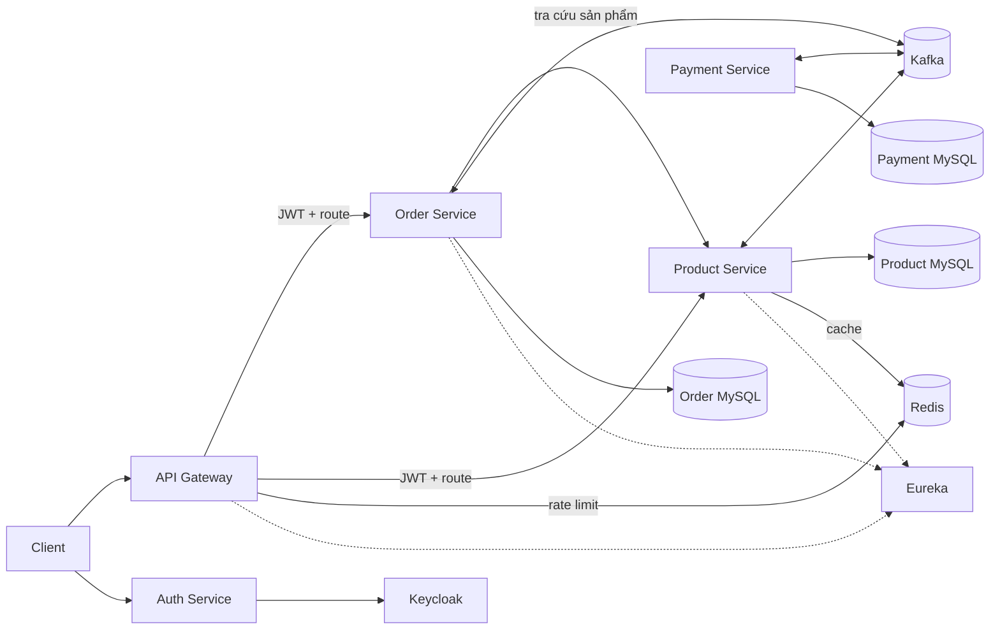
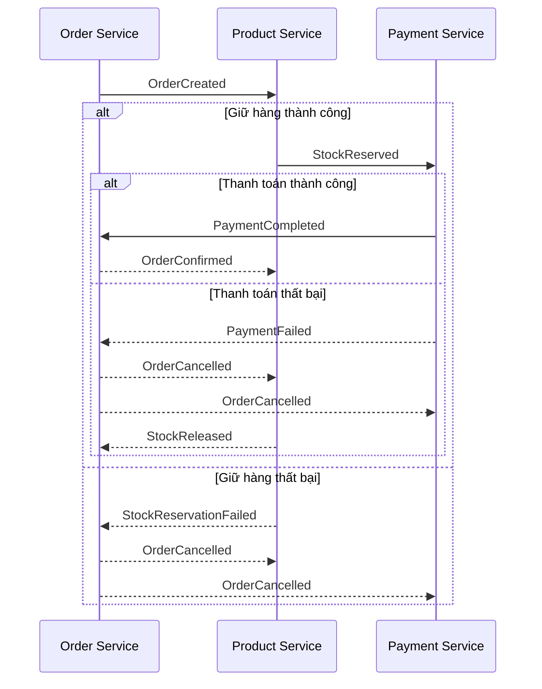
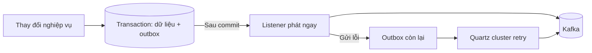
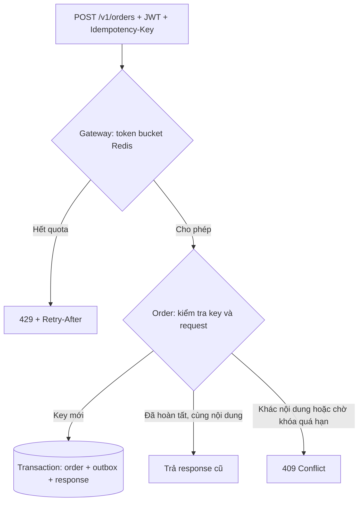

# E-commerce Microservices

Dự án backend thương mại điện tử xây dựng theo kiến trúc microservices. Các service xử lý xác thực, sản phẩm, đơn hàng và thanh toán; Kafka kết nối các bước xử lý đơn hàng bất đồng bộ. Dự án tập trung vào giao dịch phân tán, đảm bảo phát sự kiện và bảo vệ API đặt hàng khi client retry hoặc gửi quá nhiều request.

## Kiến trúc



| Thành phần | Vai trò | Cổng local |
| --- | --- | --- |
| API Gateway | Xác thực JWT, định tuyến và giới hạn request đặt hàng | 8282 |
| Auth Service | Đăng ký, đăng nhập qua Keycloak | 8083 |
| Order Service | Tạo đơn, quản lý trạng thái saga và idempotency | 8084 |
| Product Service | Quản lý sản phẩm, cache và đặt/hoàn tồn kho | 8888 |
| Payment Service | Xử lý trạng thái thanh toán trong saga | 8890 |
| Service Discovery | Đăng ký và khám phá service với Eureka | 8761 |
| Keycloak | Quản lý danh tính và cấp JWT | 8080 |
| MySQL | Lưu dữ liệu nghiệp vụ, outbox và trạng thái Quartz | 3309 |
| Redis | Cache sản phẩm và giới hạn request phân tán | 6380 |
| Kafka | Truyền event bất đồng bộ giữa các service | 9092 |
| Quartz | Retry outbox theo cụm | — |
| ELK (Elasticsearch, Logstash, Kibana) | Thu thập, lưu trữ và trực quan hóa log | 9200, 5000, 5044, 5601 |

Payment Service hiện mô phỏng trạng thái thanh toán; dự án chưa tích hợp cổng thanh toán thực tế.

## Công nghệ

- **Backend:** Java 21, Spring Boot 3, Spring Web/WebFlux, Spring Data JPA, Maven.
- **Microservices và bảo mật:** Spring Cloud Gateway, Netflix Eureka, Spring Security OAuth2 Resource Server, Keycloak và JWT.
- **Dữ liệu và giao tiếp:** MySQL, Redis, Apache Kafka; Redisson hỗ trợ khóa phân tán cho sản phẩm.
- **Xử lý nền:** Quartz JDBC JobStore chạy theo cụm để retry outbox.
- **Quan sát hệ thống:** Elasticsearch, Logstash, Kibana và log JSON.
- **Hạ tầng local:** Docker Compose, Kafka UI và RedisInsight.

## Các use case nổi bật

### 1. Saga Choreography: xử lý đơn hàng

- Các service tự xử lý event và trạng thái, không cần orchestrator tập trung.
- Khi giữ hàng hoặc thanh toán thất bại, Order Service hủy đơn để các service hoàn tác.
- Event được giữ trên Kafka 7 ngày để hỗ trợ replay.




### 2. Transactional Outbox: phát event đáng tin cậy

- Order, Product và Payment lưu dữ liệu nghiệp vụ cùng event trong một transaction.
- Listener phát event ngay sau commit; Quartz cluster retry event còn lại khi gặp lỗi.
- Event có thể được gửi lại, vì vậy consumer cần xử lý event trùng.




### 3. Rate limiting và idempotency khi đặt hàng

- Gateway giới hạn mỗi user 10 token, hồi 1 token mỗi 6 giây; retry vẫn tính quota.
- `Idempotency-Key` là UUID có hiệu lực 24 giờ; retry cùng nội dung trả response cũ, nội dung khác trả `409`.
- JWT cần claim `customer_id` khớp `customerId` trong request.




## Chạy local

Yêu cầu Java 21 và Docker Compose.

```bash
docker compose up -d
cd service_discovery && ./mvnw spring-boot:run
```

Khởi chạy các service còn lại bằng `./mvnw spring-boot:run` trong thư mục tương ứng. Trước khi chạy, cấu hình MySQL, Redis và Keycloak trong `application.yml`; tạo database, bảng Quartz và Keycloak claim `customer_id`. Compose chỉ khởi chạy hạ tầng.
